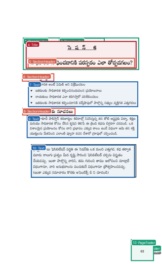
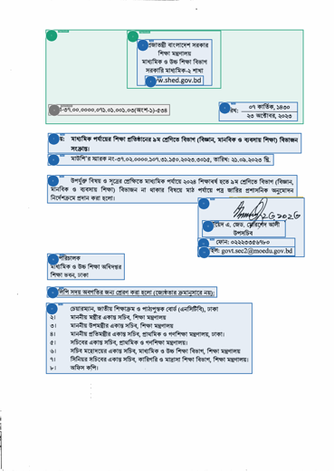

---
language:
  - en
  - as
  - bn
  - brx
  - doi
  - gu
  - hi
  - kn
  - ks
  - kok
  - mai
  - ml
  - mni
  - mr
  - ne
  - or
  - pa
  - sa
  - sat
  - sd
  - ta
  - te
  - ur
license: other
pipeline_tag: image-to-text
tags:
  - ocr
  - document-parsing
  - layout-analysis
  - reading-order
  - indic
  - vision-language-model
metrics:
  - wer
inference: false
---

<h1 id="indicdocparser" style="color:#F97316;">IndicDocParser</h1>

<div align="center">

[](#model-architecture)
[](#model-architecture)
[](#model-architecture)
[](#supported-languages)
[](#license--terms-of-use)

</div>

**Block-level document parsing for English and 22 Indian languages. Page image in, reading-ordered Markdown and per-block JSON out.**

**Quick links**: [Blog](#) · [Demo](#) · [Try it out](#) · [GitHub](https://github.com/AshwinSankar17/bodhan_gen_ai_tools)

**IndicDocParser** reads a document page and returns its text in reading order. It is a modular, two-stage parser: a **layout** model finds the blocks on the page (paragraphs, headings, tables, equations, figures) and orders them, and a **recognizer** transcribes each block. Math comes back as LaTeX and tables as Markdown.

Because the stages are separate, you can take the layout on its own, swap in your own layout, or run only the recognizer. The layout intermediate is a plain JSON file passed between the two steps.

> ### ⚠️ Confidential, Private Preview
> These weights are shared for evaluation only. Please do not redistribute them or publish outputs attributed to the model without written permission from Bodhan AI.

---

<h2 id="why-choose-indicdocparser" style="color:#F97316;">Why Choose IndicDocParser?</h2>

- 🧩 **Modular two stages.** Layout and OCR are separate steps with a plain-JSON handoff, so you can inspect or replace either half.
- 🔢 **Layout with reading order.** A single model detects blocks *and* orders them, so the output reads top-to-bottom, column-by-column, not a bag of boxes.
- 🧮 **Math as LaTeX, tables as Markdown.** Equations are transcribed to LaTeX (`$…$` / `$$…$$`) and tables to GitHub-flavored Markdown, inline with the surrounding prose.
- 🇮🇳 **Indic-first.** Trained for Indian scripts and English, across printed and handwritten pages.
- 🧹 **Furniture dropped.** Page numbers, running headers and footers, and figures are left out of the transcribed text.

---

<h2 id="layout--reading-order" style="color:#F97316;">Layout &amp; Reading Order</h2>

The layout stage on real pages across scripts and conditions. Coloured boxes are the detected blocks (colour = type) and the numbered badge on each block is its **reading-order** position. Click any page to open it full size.

<table>
<tr>
<td align="center"><a href="https://huggingface.co/oikantik-bodhan/indic-doc-parser/resolve/main/assets/layout-hindi.png"></a><br/><sub>Hindi · legal notice</sub></td>
<td align="center"><a href="https://huggingface.co/oikantik-bodhan/indic-doc-parser/resolve/main/assets/layout-english.png"></a><br/><sub>English · vintage newspaper</sub></td>
<td align="center"><a href="https://huggingface.co/oikantik-bodhan/indic-doc-parser/resolve/main/assets/layout-telugu.png"></a><br/><sub>Telugu · textbook</sub></td>
</tr>
<tr>
<td align="center"><a href="https://huggingface.co/oikantik-bodhan/indic-doc-parser/resolve/main/assets/layout-bengali.png"></a><br/><sub>Bengali · old book</sub></td>
<td align="center"><a href="https://huggingface.co/oikantik-bodhan/indic-doc-parser/resolve/main/assets/layout-santali.png"></a><br/><sub>Santali · Ol Chiki journal</sub></td>
<td align="center"><a href="https://huggingface.co/oikantik-bodhan/indic-doc-parser/resolve/main/assets/layout-urdu.png"></a><br/><sub>Urdu · worksheet</sub></td>
</tr>
<tr>
<td align="center"><a href="https://huggingface.co/oikantik-bodhan/indic-doc-parser/resolve/main/assets/layout-hw-hindi.png"></a><br/><sub>Hindi · handwritten</sub></td>
<td align="center"><a href="https://huggingface.co/oikantik-bodhan/indic-doc-parser/resolve/main/assets/layout-hw-english.png"></a><br/><sub>English · handwritten</sub></td>
</tr>
</table>

---

<h2 id="supported-languages" style="color:#F97316;">Supported Languages</h2>

The model covers **English and the 22 constitutionally recognised Indian languages**.

| Group | Languages |
| --- | --- |
| **English** | English |
| **22 constitutionally recognised languages** | Assamese, Bengali, Bodo, Dogri, Gujarati, Hindi, Kannada, Kashmiri, Konkani, Maithili, Malayalam, Manipuri, Marathi, Nepali, Odia, Punjabi, Sanskrit, Santali, Sindhi, Tamil, Telugu, Urdu |

**Printed** pages are supported across all of these. **Handwriting** is supported for **English and 12 languages**: Hindi, Bengali, Telugu, Marathi, Tamil, Gujarati, Kannada, Malayalam, Odia, Punjabi, Assamese, and Urdu.

---

<h2 id="model-architecture" style="color:#F97316;">Model Architecture</h2>

IndicDocParser is a pipeline of two models that run in one process on one GPU.

| | Layout | Recognizer |
| --- | --- | --- |
| **Role** | Detect blocks + reading order | Transcribe each block |
| **Architecture** | RT-DETR / PP-DocLayoutV3 with an integrated reading-order head | `Qwen3.5` vision-language model (*Bodhan Scribe*) |
| **Base model** | PP-DocLayoutV3 (document-pretrained) | Qwen3.5-0.8B VLM |
| **Parameters** | ~33M | ~0.8B |
| **Precision** | fp32 | bf16 |
| **Checkpoint size** | 133 MB | 1.7 GB |
| **Runtime** | PyTorch | vLLM |

The recognizer uses the **Sarvam tokenizer**, a large vocabulary tuned for Indian scripts. That vocabulary is the main reason it is a little larger than English-only recognizers of a similar shape.

---

<h2 id="how-to-use-this-model" style="color:#F97316;">How to Use this Model</h2>

<h3 style="color:#F97316;">Get the model</h3>

Download the repository (code and both model weights) from the Hub. The weights are private, so log in first.

```bash
huggingface-cli login
huggingface-cli download oikantik-bodhan/indic-doc-parser --local-dir indic-doc-parser
cd indic-doc-parser
```

<h3 style="color:#F97316;">Set up the environment</h3>

One GPU, one environment. The helper script matches CUDA wheels to your driver (vLLM's default PyPI wheel targets a newer CUDA than many drivers provide), builds a venv, and checks the GPU before you rely on it.

```bash
bash envs/setup_inference_env.sh          # builds ./.venv_idp
```

> Verified stack: vLLM 0.26.1, PyTorch 2.13.0 (cu129), Transformers 5.14.1. Override the CUDA line with `CUDA_TAG=cu126 bash envs/setup_inference_env.sh` if your driver needs it.

<h3 style="color:#F97316;">Parse a page</h3>

```bash
.venv_idp/bin/python -m indic_doc_parser.cli parse page.png -o out
#   writes out/page.md and out/page.json
```

`page.png` can be a single image or a folder of images.

<h3 style="color:#F97316;">The two stages</h3>

Run layout and OCR separately. The layout file is the only thing passed between them.

```bash
# stage 1: layout + reading order (no recognizer loaded)
.venv_idp/bin/python -m indic_doc_parser.cli layout page.png -o out
#   writes out/page.layout.json

# stage 2: OCR each block in that layout
.venv_idp/bin/python -m indic_doc_parser.cli ocr out/page.layout.json -o out
#   writes out/page.md and out/page.json
```

To use a layout produced elsewhere, pass it directly: `... ocr your_layout.json --image page.png -o out`.

<h3 style="color:#F97316;">From Python</h3>

Run from the repository directory (or add it to `PYTHONPATH`).

```python
from indic_doc_parser import IndicDocParser, LayoutParser, BlockOCR

# combined
result = IndicDocParser().parse("page.png")
print(result["markdown"])

# or the two stages, swap either half
layout = LayoutParser().detect("page.png")     # stage 1
result = BlockOCR().run("page.png", layout)    # stage 2, layout can be your own
```

---

<h2 id="inputs" style="color:#F97316;">Input(s)</h2>

**Input Type(s):** Image
**Input Format(s):** `.png`, `.jpg`, `.jpeg`, `.webp`, `.bmp`, `.tif`
**Input Parameters:** Two-dimensional (2D) document page image
**Other Properties:** One page per image. A folder of images is processed as a batch.

---

<h2 id="output" style="color:#F97316;">Output</h2>

**Output Type(s):** Text (Markdown) and structured JSON
**Output Format(s):** `.md`, `.json`
**Output Parameters:** One-dimensional (1D) text, list of blocks

Two files, named after the input image:

- **`page.md`**: the page as Markdown, blocks joined in reading order, hyphenated line-breaks rejoined. Math is LaTeX, tables are Markdown.
- **`page.json`**: one entry per block, in reading order:

| Field | Meaning |
| --- | --- |
| `order` | position in reading order, starting at 0 |
| `type` | block type: `Text`, `SectionHeader`, `Title`, `ListItem`, `Table`, `Equation`, `Caption`, `Footnote` |
| `label` | the raw layout label before it is simplified to `type` |
| `bbox_xyxy` | box on the page in pixels, `[x0, y0, x1, y1]` |
| `conf` | layout detection confidence, 0 to 1 |
| `text` | the transcription (LaTeX for math, Markdown for tables) |

The **layout stage** additionally writes `page.layout.json`, the same shape without `text`, plus `image_path`, `width`, and `height`. That is the intermediate handed to the OCR stage.

---

<h2 id="performance" style="color:#F97316;">Performance</h2>

<h3 style="color:#F97316;">olmOCR-Bench (English)</h3>

Pass rate per category (higher is better). *Placeholder numbers, to be finalised after the full eval re-run.*

| System | Overall | ArXiv math | Baseline | Headers/Footers | Long/tiny text | Multi-col | Old scans | Old-scan math | Tables |
| --- | :---: | :---: | :---: | :---: | :---: | :---: | :---: | :---: | :---: |
| **IndicDocParser** | **82.9** | 84.5 | 99.2 | 98.3 | 90.3 | 73.5 | 47.3 | 80.8 | 89.5 |
| Sarvam-OCR *(reported)* | 84.3 | 86.5 | 99.6 | 96.3 | 91.0 | 82.2 | 49.8 | 81.0 | 88.3 |
| PaddleOCR-VL-1.6 *(reproduced)* | 78.7 | 85.1 | 98.7 | 95.8 | 75.1 | 84.1 | 39.0 | 68.8 | 82.9 |

<h3 style="color:#F97316;">IndicDLP (layout)</h3>

*To be added.*

---

<h2 id="software-integration" style="color:#F97316;">Software Integration</h2>

**Runtime Engine:** vLLM (recognizer) with PyTorch and Transformers (layout)

**Supported Hardware Microarchitecture Compatibility:**

- NVIDIA Ampere
- NVIDIA Hopper
- NVIDIA Lovelace

**Supported Operating System(s):** Linux

**Minimum GPU:** 24 GB. **Recommended:** 40 to 80 GB (A100 / H100). bf16, unquantised.

---

<h2 id="limitations" style="color:#F97316;">Limitations</h2>

- **Complex multi-column reading order** is the main weakness. Dense newspaper-style layouts can be mis-ordered.
- **One page per image.** PDF handling is up to the caller (render pages to images first).
- **Handwriting** varies by script and quality, and is supported for the 12 languages listed above. Very degraded scans lose accuracy.
- **Furniture is dropped by design.** If you need headers, footers, or page numbers in the output, read them from the layout JSON before reconstruction.

---

<h2 id="license--terms-of-use" style="color:#F97316;">License / Terms of Use</h2>

The layout model derives from PP-DocLayoutV3 and the recognizer from the Qwen model family, so the respective upstream licenses apply. These Private-Preview weights are additionally covered by your evaluation agreement with Bodhan AI. Access is limited to named evaluators, and the weights may not be redistributed or used to train other models without written permission.

---

<h2 id="use-case" style="color:#F97316;">Use Case</h2>

Converting document page images, printed or handwritten, English or Indian-language, into reading-ordered Markdown and per-block JSON, with math as LaTeX and tables as Markdown.

---

<h2 id="deployment-geography" style="color:#F97316;">Deployment Geography</h2>

Global

---

<h2 id="citation" style="color:#F97316;">Citation</h2>

```bibtex
@misc{indicdocparser2026,
  title  = {IndicDocParser: Block-level Document Parsing for Indian Languages},
  author = {Bodhan AI},
  year   = {2026},
  url    = {https://huggingface.co/oikantik-bodhan/indic-doc-parser}
}
```

---

<h2 id="ethical-considerations" style="color:#F97316;">Ethical Considerations</h2>

The integration of foundation and fine-tuned models into AI systems requires additional testing using use-case-specific data to ensure safe and effective deployment. Developers should work with their team to ensure this model meets requirements for the relevant industry and use case, and addresses unforeseen product misuse.
