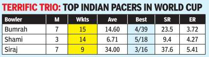

<div align="center">

[](#the-two-models)
[](#the-two-models)
[](#the-two-models)
[](#supported-languages)
[](#license)

</div>

**Document parsing for English and 22 Indian languages, printed and handwritten.** A page image
in; reading-ordered Markdown out, with math as LaTeX and tables as HTML or Markdown, plus
per-block JSON.

<div align="center">


</div>

IndicDocParser reads a document page and returns its text in reading order. It is a modular,
two-stage parser: **IndicDocLayout** finds the blocks on the page and orders them, and
**IndicBlockOCR** transcribes each block, with math produced in LaTeX format, and tables as HTML or Markdown.

Since the stages are separate, the layout module can be used as is or swapped by a different one, or
run only the block-level text recognizer. The intermediate step is a structured JSON file passed between the two.

---

<h2 id="examples" style="color:#F97316;">Examples</h2>

Detected blocks with their reading order on the left, the transcription on the right.

<div align="center">
  
  <p><b>Example #1. English page with dense mathematics.</b></p>
</div>

<div align="center">
  
  <p><b>Example #2. Printed Telugu page.</b></p>
</div>

<div align="center">
  
  <p><b>Example #3. Handwritten Hindi maths.</b></p>
</div>

---

<h2 id="the-two-models" style="color:#F97316;">The two models</h2>

| | IndicDocLayout | IndicBlockOCR |
| --- | --- | --- |
| **Role** | detect blocks + reading order | transcribe each block |
| **Architecture** | PP-DocLayoutV3 (RT-DETR) for layout detection and reading order | Qwen3.5 for text recognition |
| **Parameters** | 33 M | 0.8 B |
| **Precision** | fp32 | bf16 |
| **In this repo** | `weights/layout` (133 MB) | `weights/ocr` (1.7 GB) |

IndicBlockOCR is trained using the **Sarvam-30B tokenizer**, which has a large vocabulary tuned for good performance on Indian scripts. IndicDocLayout is a finetune based on PP-DocLayoutV3/RT-DETR, trained to predict from an education-domain focussed taxonomy of 37-classes.

---

<h2 id="supported-languages" style="color:#F97316;">Supported languages</h2>

**Printed** page recognition is supported across English and the 22 constitutionally recognised Indian languages: Assamese, Bengali, Bodo, Dogri,
Gujarati, Hindi, Kannada, Kashmiri, Konkani, Maithili, Malayalam, Manipuri, Marathi, Nepali,
Odia, Punjabi, Sanskrit, Santali, Sindhi, Tamil, Telugu, Urdu.

**Handwriting** recognition is supported for English and
12 languages: Hindi, Bengali, Telugu, Marathi, Tamil, Gujarati, Kannada, Malayalam, Odia,
Punjabi, Assamese and Urdu. We are very excited to take this first step in supporting handwriting recognition across many Indian languages, and are working on improving quality further, and adding support for other languages as well.

---

<h2 id="how-to-use-this-model" style="color:#F97316;">How to Use this Model</h2>

<h3 style="color:#F97316;">Installation</h3>

The repo ships an installer that reads your driver and picks matching CUDA wheels. If you work in a
virtual environment, please activate it first, as the installer installs into whichever
Python is active.

```bash
IDP=$(python -c "from huggingface_hub import snapshot_download as d; print(d('bodhan-ai/indic-doc-parser'))")
cd "$IDP" && ./install.sh
```

It will use `uv` if that is available, and `pip` otherwise. Where running a shell script is not
convenient, [TROUBLESHOOTING.md](TROUBLESHOOTING.md) lists the two commands it runs.

<h3 style="color:#F97316;">Basic inference</h3>

```python
import sys
from huggingface_hub import snapshot_download

repo = snapshot_download("bodhan-ai/indic-doc-parser")
sys.path.insert(0, repo)                    # the code ships in the repo
from indic_doc_parser import IndicDocParser

parser = IndicDocParser.from_pretrained(repo)

page = parser.parse("page.png")
print(page["markdown"])                     # reading-ordered Markdown
```

`page` also carries the per-block detail, which you can save as follows:

```python
import json

with open("page.json", "w", encoding="utf-8") as f:
    json.dump(page, f, ensure_ascii=False, indent=2)
```

<h3 style="color:#F97316;">Running one stage at a time</h3>

To decompose into 2 separate stages:

```python
from indic_doc_parser import IndicDocLayout, IndicBlockOCR

layout = IndicDocLayout(f"{repo}/weights/layout").detect("page.png")
page = IndicBlockOCR(f"{repo}/weights/ocr").run("page.png", layout)
```

`run()` takes a layout object, a dict, or the path to a layout JSON file.

---

<h2 id="output" style="color:#F97316;">Output</h2>

`parser.parse(page)` returns the page and its blocks in reading order:

```json
{
  "image": "sample1.png",
  "width": 800,
  "height": 1273,
  "blocks": [
    {"order": 0, "label": "Header", "type": "PageHeader",
     "bbox_xyxy": [345.6, 51.7, 437.1, 114.7], "conf": 0.6, "text": ""},
    {"order": 1, "label": "Page-number", "type": "PageNumber",
     "bbox_xyxy": [367.8, 78.9, 413.2, 107.4], "conf": 0.747, "text": "229"},
    {"order": 2, "label": "Paragraph", "type": "Text",
     "bbox_xyxy": [77.9, 121.3, 711.8, 199.4], "conf": 0.863,
     "text": "Thus we see that, if we can prove that twice the L.H.S. of (30) ..."}
  ]
}
```

| field | meaning |
| --- | --- |
| `order` | reading-order rank, 0-based and gap-free |
| `label` | the raw IndicDocLayout class (37-class taxonomy) |
| `type` | coarse pipeline category: `Text`, `Table`, `Equation`, `Title`, ... |
| `bbox_xyxy` | pixel box `[x0, y0, x1, y1]` |
| `conf` | detection confidence |
| `text` | transcription; `""` for blocks not sent to the recognizer |

**Note:** Figures, charts, advertisements and running headers and footers are not sent through the recognizer model by default, but
they remain in the JSON with `text: ""`, so you can see what was detected and where. Page numbers
and other margin text like folio *are* transcribed.

<h3 style="color:#F97316;">Table format</h3>

Tables come back as HTML by default. Choose the format when you construct the parser:

```python
parser = IndicDocParser.from_pretrained(repo)                            # HTML (default)
parser = IndicDocParser.from_pretrained(repo, table_format="markdown")   # Markdown
```

A newspaper table and what the default HTML output looks like:

<table>
<tr>
<td width="42%" valign="top" align="center">

</td>
<td width="58%" valign="top">
<pre><code>&lt;table&gt;
&lt;thead&gt;
&lt;tr&gt;
&lt;th colspan=&quot;7&quot;&gt;TERRIFIC TRIO: TOP INDIAN PACERS IN WORLD CUP&lt;/th&gt;
&lt;/tr&gt;
&lt;tr&gt;
&lt;th&gt;Bowler&lt;/th&gt;
&lt;th&gt;M&lt;/th&gt;
&lt;th&gt;Wkts&lt;/th&gt;
&lt;th&gt;Ave&lt;/th&gt;
&lt;th&gt;Best&lt;/th&gt;
&lt;th&gt;SR&lt;/th&gt;
&lt;th&gt;ER&lt;/th&gt;
&lt;/tr&gt;
&lt;/thead&gt;
&lt;tbody&gt;
&lt;tr&gt;
&lt;td&gt;Bumrah&lt;/td&gt;
&lt;td&gt;7&lt;/td&gt;
&lt;td&gt;15&lt;/td&gt;
&lt;td&gt;14.60&lt;/td&gt;
&lt;td&gt;4/39&lt;/td&gt;
&lt;td&gt;23.5&lt;/td&gt;
&lt;td&gt;3.72&lt;/td&gt;
&lt;/tr&gt;
&lt;tr&gt;
&lt;td&gt;Shami&lt;/td&gt;
&lt;td&gt;3&lt;/td&gt;
&lt;td&gt;14&lt;/td&gt;
&lt;td&gt;6.71&lt;/td&gt;
&lt;td&gt;5/18&lt;/td&gt;
&lt;td&gt;9.4&lt;/td&gt;
&lt;td&gt;4.27&lt;/td&gt;
&lt;/tr&gt;
&lt;tr&gt;
&lt;td&gt;Siraj&lt;/td&gt;
&lt;td&gt;7&lt;/td&gt;
&lt;td&gt;9&lt;/td&gt;
&lt;td&gt;34.00&lt;/td&gt;
&lt;td&gt;3/16&lt;/td&gt;
&lt;td&gt;37.6&lt;/td&gt;
&lt;td&gt;5.41&lt;/td&gt;
&lt;/tr&gt;
&lt;/tbody&gt;
&lt;/table&gt;</code></pre>
</td>
</tr>
</table>

The title banner is one cell spanning seven columns, which is why HTML is the default. Markdown has
no `colspan`, so the same banner comes back repeated once per column and the real header row is
pushed into the body. Every data cell survives either way; what you lose is the structure.

---

<h2 id="performance" style="color:#F97316;">Performance</h2>

<h3 style="color:#F97316;">olmOCR-Bench (English)</h3>

| System | Overall | ArXiv math | Baseline | Headers/Footers | Long/tiny | Multi-col | Old scans | Old-scan math | Tables |
| --- | :---: | :---: | :---: | :---: | :---: | :---: | :---: | :---: | :---: |
| **IndicDocParser** | **82.9** | 84.5 | 99.2 | 98.3 | 90.3 | 73.5 | 47.3 | 80.8 | 89.5 |
| Sarvam-OCR  | 84.3 | 86.5 | 99.6 | 96.3 | 91.0 | 82.2 | 49.8 | 81.0 | 88.3 |
| PaddleOCR-VL-1.6  | 78.7 | 85.1 | 98.7 | 95.8 | 75.1 | 84.1 | 39.0 | 68.8 | 82.9 |

Re-measurement under the shipped configuration is pending.

<h3 style="color:#F97316;">Printed Recognition Performance</h3>

Needs reevaluation.

<h3 style="color:#F97316;">Handwriting Recognition Performance</h3>

Needs reevaluation.

---

<h2 id="limitations" style="color:#F97316;">Limitations</h2>

- We are currently working on better support for **complex multi-column reading order**. Additionally, we are working on better support for **Handwriting** across children versus adult handwriting, and also extending support to other Indic languages.


---

<h2 id="hardware" style="color:#F97316;">Hardware</h2>

Latency and throughput numbers to follow.

---

<h2 id="license" style="color:#F97316;">License</h2>

**Apache 2.0**, inherited cleanly from everything it is built on: PP-DocLayoutV3 (Apache 2.0),
Qwen3.5 (Apache 2.0), and the Sarvam-30B tokenizer (Apache 2.0). You may use, modify, finetune
and redistribute, with attribution and a copy of the licence.

---

<h2 id="citation" style="color:#F97316;">Citation</h2>

```bibtex
@misc{indicdocparser2026,
  title  = {IndicDocParser: Multilingual 2-stage Document Parsing for 22 Indian Languages and English},
  author = {Bodhan.AI},
  year   = {2026},
  url    = {https://huggingface.co/bodhan-ai/indic-doc-parser}
}
```
